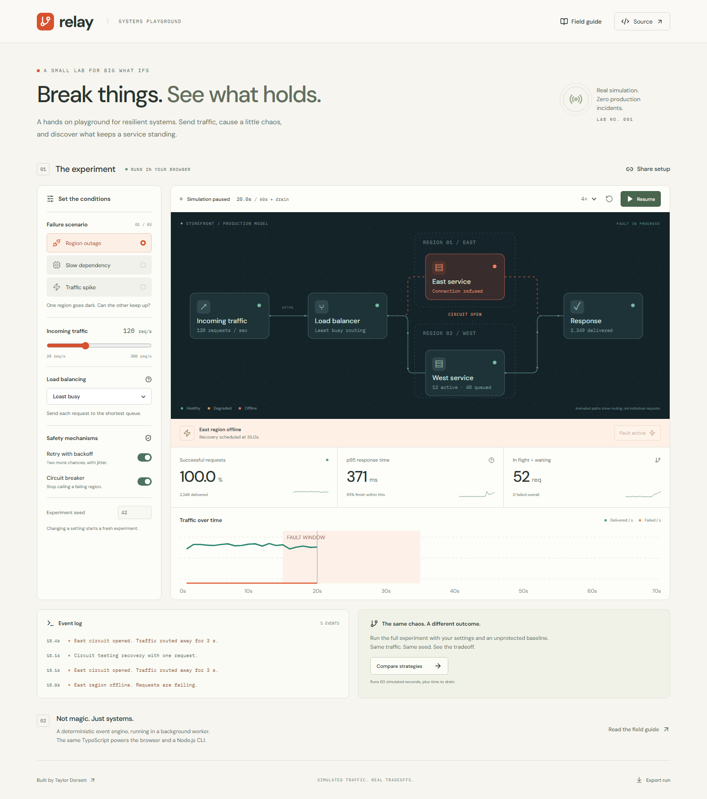

# relay

Break things. See what holds.

Relay is a reliability playground. Send traffic through two service regions, take one offline, and see what happens when you add retries, change routing, or open a circuit breaker.

The diagram uses a shopping app example: React frontend, NGINX load balancer, and two Node.js API servers. It also explains where a Redis cache and PostgreSQL database would fit. Those names make the roles concrete. The simulation covers API traffic and failures, not cache behavior or database queries.

[Open the lab](https://www.taylordorsett.com/relay/) · [How it works](docs/engineering.md) · [Interview walkthrough](docs/walkthrough.md)



## Try this first

1. Run the default experiment.
2. At 15 seconds, east goes offline. Watch the circuit open and traffic move west.
3. Compare strategies. Both runs get the same traffic, service costs, and fault schedule.
4. Increase traffic to 240 requests per second. There is no policy that creates unlimited capacity.

The default experiment delivers 6,064 of 7,200 requests without protection and 7,139 with the default protections. Successful request p95 rises from 138 ms to 847 ms. Retries recover requests, but they also add work and waiting. These are results from this model, not measurements of a production system.

## Run it locally

Node 24.12 or newer is required. Node 24 is used in CI.

```sh
npm ci
npm run dev
```

Open the printed URL with `/relay/` at the end.

The simulation also runs directly in Node. It uses the same TypeScript engine as the browser worker.

```sh
npm run simulate
npm run simulate -- --fault latency --rate 200 --seed 17
npm run simulate -- --fault surge --json
```

Use `node src/cli.ts --json > report.json` for a clean JSON file without npm's script header.

## What's here

React and TypeScript for the interface. SVG for the network and charts. A Web Worker for the simulation. A stable binary heap for event scheduling. Node's test runner for the model. Playwright and axe for browser checks. Vite for a static production build.

Three fault scenarios, two routing policies, bounded queues, retries with jitter, a circuit breaker state machine, seeded experiments, shareable URLs, JSON reports, a comparison view, and a field guide.

No AI, accounts, API keys, paid services, or backend to keep alive. GitHub Pages serves the app. Node is used for the CLI, tests, and build. GitHub Pages does not run a Node server.

## Where things live

| Location | What it owns |
| --- | --- |
| `src/main.tsx` and `src/App.tsx` | Startup and page layout |
| `src/components/` | Controls, topology, charts, results, and field guide |
| `src/hooks/useExperiment.ts` | Run state, worker lifecycle, sharing, and exports |
| `src/worker.ts` and `src/worker-messages.ts` | Background playback and typed messages |
| `src/simulation/` | Engine, configuration, event queue, and data types |
| `src/styles/` | Styles grouped by page area, with responsive rules loaded last |
| `src/cli.ts` | Node command line entry |
| `tests/` | Engine invariants and browser behavior |

Start with `App.tsx` for the interface or `simulation/engine.ts` for the model. The [engineering notes](docs/engineering.md) explain the algorithms and tradeoffs. Comments in the code focus on decisions that are not obvious from the names.

## Checks

```sh
npm test
npm run build
npx playwright install chromium
npm run test:browser
```

Engine tests cover determinism, playback independence, recovery, saturation, input validation, reproducible fault injection, and request accounting across 36 scenario and policy combinations. Browser tests cover the real worker, controls, comparison results, sharing, exports, keyboard dismissal, overflow, and serious accessibility violations on desktop and phone sizes.

GitHub Actions checks PRs. A successful main branch check starts deployment. A failed check does not publish. Screenshots are in `docs/screenshots/`. To refresh them, run a production preview on port 4173, then `node scripts/capture.mjs`.

## PR previews

PR Preview Action is pinned to `rossjrw/pr-preview-action@v1.8.2`. PRs from branches in this repo get a preview link and QR code in a sticky comment. New commits update the preview. Closing or merging the PR removes it.

Preview URLs use `/relay/pr-preview/pr-NUMBER/`. Vite builds each preview for that exact path, including the worker and assets. Fork PRs still run checks but do not receive write permissions or a hosted preview.

Pages publishes from the root of `gh-pages`. Production updates preserve `pr-preview/`, and both workflows share a deployment queue. Do not switch Pages back to the GitHub Actions source or force push the deployment branch.

## Limits

This is an educational model. Requests arrive at fixed intervals. Each region has 12 concurrent workers and an 80 request queue. The model omits real networking, connection pools, databases, and cloud infrastructure. Its animation illustrates routing rather than individual packets. See the engineering notes before using the numbers in a presentation.

MIT license.
